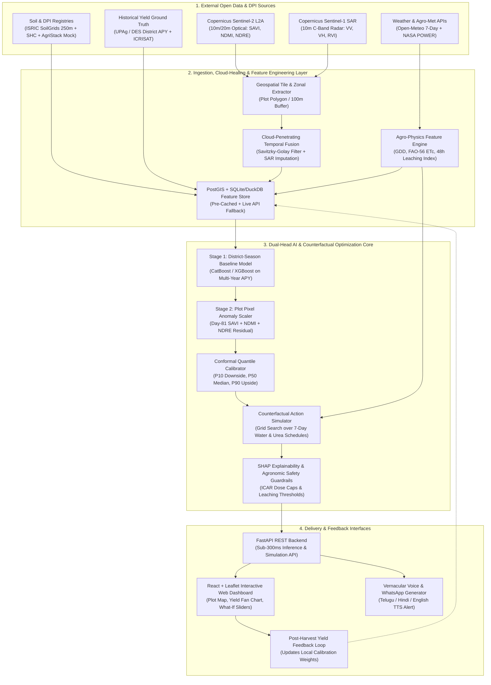

# 05 — System & AI Technical Architecture

**Contributor:** `Gemini_1` | **Date:** November 13, 2026

## 1. End-to-End System Architecture Diagram (Section 9D)



---

## 2. Real-Time Inference & Counterfactual Simulation Sequence

```mermaid
sequenceDiagram
    autonumber
    actor Farmer as Farmer / FPO User
    participant UI as React PWA / WhatsApp UI
    participant API as FastAPI Orchestrator
    participant Geo as Satellite & Soil Cache/API
    participant ML as Conformal Yield Model (CatBoost)
    participant Opt as Counterfactual Action Solver

    Farmer->>UI: Selects Plot Pin + Crop (Paddy) + Sowing Date
    UI->>API: POST /api/v1/analyze-plot {lat, lon, crop, sow_date}
    par Parallel Data Retrieval
        API->>Geo: Fetch Sentinel-2 (SAVI, NDMI, NDRE) + Sentinel-1 (VV/VH)
        API->>Geo: Fetch SoilGrids/SHC (N, P, K, pH, SOC, Texture)
        API->>Geo: Fetch 7-Day Forecast (Rain mm, Prob %, Temp, ET0)
    end
    Geo-->>API: Unified Spatio-Temporal Feature Vector + Completeness Score
    API->>ML: Predict Calibrated Yield Distribution (P10, P50, P90)
    ML-->>API: Yield {P10: 18.2, P50: 22.4, P90: 25.1 qtl/acre} + SHAP Drivers
    API->>Opt: Simulate 7-Day Actions (Routine vs Delay 4d vs Split Dose)
    Opt-->>API: Ranked Actions by Net ROI (₹ Saved + Litres Saved + Yield Delta)
    API-->>UI: JSON Payload (Map Layers, Yield Fan, Counterfactual Cards, Audio URL)
    UI-->>Farmer: Displays Interactive Comparison + Plays 15s Telugu/Hindi Voice Note
```

---

## 3. Deep Breakdown of Technical Subsystems

### 3.1 Spectral Index Mathematical Formulations (Sentinel-2 + Sentinel-1)
Instead of relying solely on standard NDVI (which saturates at high leaf area index in irrigated paddy after 60 days), our feature pipeline computes four complementary indices from [Copernicus Sentinel-2 L2A](https://documentation.dataspace.copernicus.eu/Data/Sentinel2.html) and [Sentinel-1 SAR](https://documentation.dataspace.copernicus.eu/Data/Sentinel1.html):

1. **Soil-Adjusted Vegetation Index ($\text{SAVI}$) — Primary Yield Predictor:**
   $$\text{SAVI} = \frac{(B_8 - B_4)}{(B_8 + B_4 + L)} \times (1 + L), \quad L = 0.5$$
   *Why it matters:* Minimizes wet/dry background soil brightness reflections and achieves high correlation with paddy yield at **81 days after transplantation** (compared to 116 days for NDVI) ([IJISAE Karnataka Study](https://ijisae.org/index.php/IJISAE/article/view/2326)).
2. **Normalized Difference Moisture Index ($\text{NDMI}$) — Canopy Water Stress:**
   $$\text{NDMI} = \frac{(B_8 - B_{11})}{(B_8 + B_{11})}$$
   *Why it matters:* Uses Short-Wave Infrared ($B_{11}$ at 1610 nm, 20m resampled to 10m) which is strongly absorbed by leaf water content, detecting root-zone water deficit days before visible wilting ([ResearchGate Sentinel-2 NDMI](https://www.researchgate.net/figure/Time-series-of-changes-in-NDMI-index-based-on-Sentinel-2_fig5_374380202)).
3. **Normalized Difference Red-Edge ($\text{NDRE}$) — Pre-Visual Nitrogen Proxy:**
   $$\text{NDRE} = \frac{(B_8 - B_5)}{(B_8 + B_5)}$$
   *Why it matters:* Red-Edge Band 5 (705 nm) penetrates deeper into dense crop canopies than red light ($B_4$) and tracks chlorophyll concentration directly linked to leaf nitrogen status.
4. **Radar Vegetation Index ($\text{RVI}$) — Cloud-Proof Monsoon Fallback:**
   $$\text{RVI} = \frac{4 \cdot \sigma^0_{VH}}{\sigma^0_{VV} + \sigma^0_{VH}}$$
   *Why it matters:* When Sentinel-2 optical Scene Classification (`SCL`) flags cloud/shadow classes, Sentinel-1 C-band SAR cross-polarization (`VH/VV`) tracks structural crop growth and surface waterlogging through 100% cloud cover ([MDPI SAR-Optical Study](https://www.mdpi.com/2072-4292/17/8/1412)).

### 3.2 Hierarchical District-to-Plot Yield Calibration
A critical scientific pitfall in Indian hackathons is training a model on district-level yields ([UPAg](https://upag.gov.in/)) and claiming it directly predicts a 1-acre plot without spatial scaling. We solve this transparently with a **Two-Stage Hierarchical Architecture**:
* **Stage 1 (Macro Spatio-Temporal Regressor):** A **CatBoost / XGBoost Quantile Ensemble** trained on 20+ years of district-level seasonal yield panels (`UPAg / ICRISAT` across 500+ districts) paired with district-aggregated seasonal weather (`GDD`, rainfall anomalies, dry-spell counts), soil baselines, and satellite vegetation integrals ($\int \text{SAVI}\,dt$). This predicts the **District-Season Baseline Yield Distribution ($\hat{Y}_{\text{dist}}$)**.
* **Stage 2 (Plot-Level Pixel Anomaly Adjustment):** For an individual farm plot $i$ inside district $d$, we compute the plot's vegetation and moisture relative anomaly at growth day $t$ (e.g., Day 81) relative to the surrounding cropped pixels in that mandal/district:
  $$\hat{Y}_{\text{plot}, i}(q) = \hat{Y}_{\text{dist}, d}(q) \times \left(1 + \alpha_c \cdot \frac{\text{SAVI}_{i,t} - \overline{\text{SAVI}}_{d,t}}{\overline{\text{SAVI}}_{d,t}} + \beta_c \cdot \Delta\text{Stress}_{i,t}\right)$$
  where $\alpha_c, \beta_c$ are crop-specific elasticity coefficients bounded by agronomic ceilings, and $q \in \{0.10, 0.50, 0.90\}$ are conformal quantiles.

### 3.3 The Counterfactual Resource Optimization Engine
For any candidate 7-day intervention schedule $a = (\text{Irrig}_{d}, \text{Urea}_{d})$ over days $d \in \{1..7\}$:
1. **Leaching Loss Model ($L_{\text{urea}}$):** If daily rainfall $R_d + \text{Irrig}_d$ exceeds soil field capacity threshold $\theta_{\text{FC}}$ (derived from SoilGrids sand/clay texture) within 48 hours of urea application, nitrogen leaching loss rises non-linearly from baseline losses toward 65–80%, consistent with ICAR's documented 30–45% Nitrogen NUE ([PIB 2026](https://www.pib.gov.in/PressReleasePage.aspx?PRID=2237709)).
2. **FAO-56 Water Stress & Yield Penalty ($\Delta Y_{\text{water}}$):** Uses the FAO-56 yield-response equation:
   $$1 - \frac{Y_a}{Y_m} = K_y \left(1 - \frac{ET_a}{ET_c}\right)$$
   where $K_y$ is the growth-stage sensitivity factor (high during flowering/grain-filling, low during late vegetative/ripening).
3. **Objective Function Ranked for the Farmer:**
   $$\max_{a \in \mathcal{A}} \text{NetBenefit}(a) = \left(\hat{Y}(a) - \hat{Y}(\text{routine})\right) \cdot P_{\text{MSP}} + C_{\text{urea\_saved}}(a) + C_{\text{water\_saved}}(a)$$
   Subject to strict **ICAR Agronomic Guardrails** (never exceeding recommended N-P-K caps for that crop and stage).
